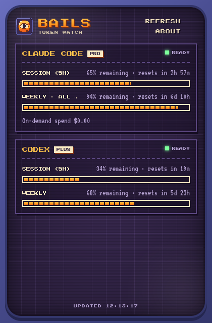

<div align="center">


# BAILS

**TOKEN WATCH** · *le jeton qui garde un œil sur vos tokens*

Une petite fenêtre de bureau rétro-arcade qui affiche, en temps réel, l'usage de vos abonnements CLI IA :
fenêtres de rate-limit, % restant et compte à rebours avant reset.




</div>

---

## ▶ PRESS START

```sh
npm install
npm run dev        # lancer en dev (rechargement à chaud de l'UI)
npm test           # tests des parsers et du service
npm run typecheck  # vérification TypeScript
npm run build      # build de production dans out/
npm start          # lancer le build de production
```

> 💡 Les messages `Fontconfig warning` et `GetVSyncParametersIfAvailable() failed` au lancement
> viennent du système / de Chromium et sont sans conséquence.

## 💾 INSTALLATION

Téléchargez l'installeur de votre OS dans les [Releases](https://github.com/hansipie/Bails/releases) :

| OS | Fichier |
|---|---|
| macOS (Apple Silicon) | `Bails-x.y.z-mac-arm64.dmg` |
| macOS (Intel) | `Bails-x.y.z-mac-x64.dmg` |
| Windows | `Bails-x.y.z-win-x64.exe` |
| Linux (toutes distros) | `Bails-x.y.z-linux-x86_64.AppImage` |
| Debian / Ubuntu | `Bails-x.y.z-linux-amd64.deb` |
| Fedora / RHEL | `Bails-x.y.z-linux-x86_64.rpm` |

> ⚠️ **Les binaires ne sont pas signés** par un certificat Apple / Microsoft.
> - **macOS** : au premier lancement, clic droit sur l'app › *Ouvrir*, ou :
>   `xattr -cr /Applications/Bails.app`
> - **Windows** : SmartScreen › *Informations complémentaires* › *Exécuter quand même*.
> - **AppImage** : `chmod +x Bails-*.AppImage` puis lancez-le.

## 🚀 RELEASE

```sh
npm version patch          # ou minor / major : met à jour package.json et crée le tag vX.Y.Z
git push --follow-tags     # le workflow GitHub construit macOS, Windows, Linux et publie la release
```

Le workflow [`.github/workflows/release.yml`](.github/workflows/release.yml) vérifie que le tag
correspond à la version de `package.json`, lance typecheck + tests, package les 3 OS puis publie
la release avec les installeurs et un fichier `SHA256SUMS.txt`.
Il peut aussi être lancé à la main (onglet *Actions*) pour un build sans release.

En local, `npm run dist` construit les installeurs de l'OS courant dans `dist/`
(`dist:linux`, `dist:win`, `dist:mac` pour cibler un OS ; le `.dmg` exige macOS, le `.rpm` exige `rpmbuild`).

## 🕹️ FEATURES

- **Claude Code** et **Codex** : session 5 h, quota hebdomadaire, dépense on-demand.
- **Jauges pixel** façon barre d'énergie : orange → jaune sous 20 % → rouge clignotant à sec.
- **Compte à rebours** avant chaque reset, rafraîchi toutes les 30 s.
- **Auto-refresh** toutes les 5 min, bouton `REFRESH ◀` pour forcer.
- **Email masqué** par défaut (flou), un clic pour le révéler.
- **Commande de connexion à copier** quand un provider n'est pas connecté.
- **100 % local** : polices embarquées, aucune télémétrie, credentials en lecture seule.

## ⚙️ HOW IT WORKS

| Provider | Credentials lus (lecture seule) | Endpoint |
|---|---|---|
| Claude Code | `$CLAUDE_CONFIG_DIR/.credentials.json` (défaut `~/.claude`) | `GET https://api.anthropic.com/api/oauth/usage` (`anthropic-beta: oauth-2025-04-20`) |
| Codex | `$CODEX_HOME/auth.json` (défaut `~/.codex`) | `GET https://chatgpt.com/backend-api/wham/usage` (`chatgpt-account-id`) |

Les fichiers de credentials ne sont **jamais réécrits** et les tokens ne sont jamais rafraîchis :
si un token est expiré ou rejeté, la carte invite à relancer `claude` / `codex login`.
Ces endpoints ne sont pas documentés publiquement et peuvent changer : les parsers sont
volontairement tolérants (plusieurs noms de champs acceptés).

Le `UsageService` (process main) met le rapport en cache 2 min, dédoublonne les requêtes
concurrentes et applique un backoff exponentiel par provider sur HTTP 429 (1 → 15 min) en
continuant d'afficher le dernier résultat valide.

```
src/
├── main/            process Electron : fenêtre, IPC, UsageService
│   └── usage/
│       └── providers/   claude.ts, codex.ts
├── preload/         expose window.bails.usage au renderer
├── renderer/        UI React (thème arcade : styles.css, UsageView.tsx)
└── shared/          types partagés (UsageReport, UsageSnapshot…)
resources/           icône de l'app (icon.svg source, icon.png 512×512)
```

## ➕ ADD A PLAYER (nouveau provider)

1. Créer `src/main/usage/providers/<nom>.ts` qui exporte un `UsageProvider` :

   ```ts
   export const monProvider: UsageProvider = {
     id: "mon-provider",
     label: "Mon Provider",
     async fetchSnapshot(ctx) {
       // lire les credentials, appeler getJson(ctx, url, headers),
       // retourner un UsageSnapshot (errorSnapshot(...) pour les cas d'échec)
     }
   };
   ```

2. L'ajouter à la liste de `src/main/usage/providers/index.ts`.

Rien d'autre à toucher : le service, l'IPC et l'UI sont génériques.
Renvoyer `cta: { kind: "terminal", title, command }` pour afficher une commande de connexion à copier.
Pour un nouveau type d'aide (ex. un formulaire de cookie), ajouter une variante à `UsageCta`
dans `src/shared/usage.ts` et son rendu dans `CtaBlock`.

## 🎨 THEME

| Rôle | Couleur |
|---|---|
| Écran | `#2b1f3d` / `#3a2a52` |
| Cadre | `#4b4f93` |
| Orange (titres, jauges) | `#ffc24a` → `#ff9a1f` → `#f2661c` |
| Texte | `#f7e7c1` |

Polices : [Press Start 2P](https://fonts.google.com/specimen/Press+Start+2P) (titres, labels) et
[VT323](https://fonts.google.com/specimen/VT323) (texte, chiffres), embarquées via `@fontsource`.
Icône pixel-art 32×32 dessinée par Codex.

<div align="center">

**GAME OVER?** &nbsp;·&nbsp; *INSERT COIN TO CONTINUE* &nbsp;◀

</div>
