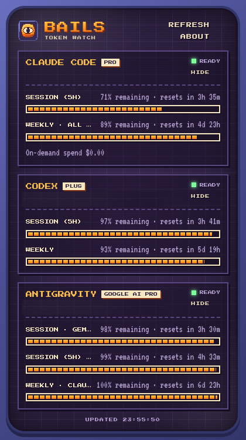
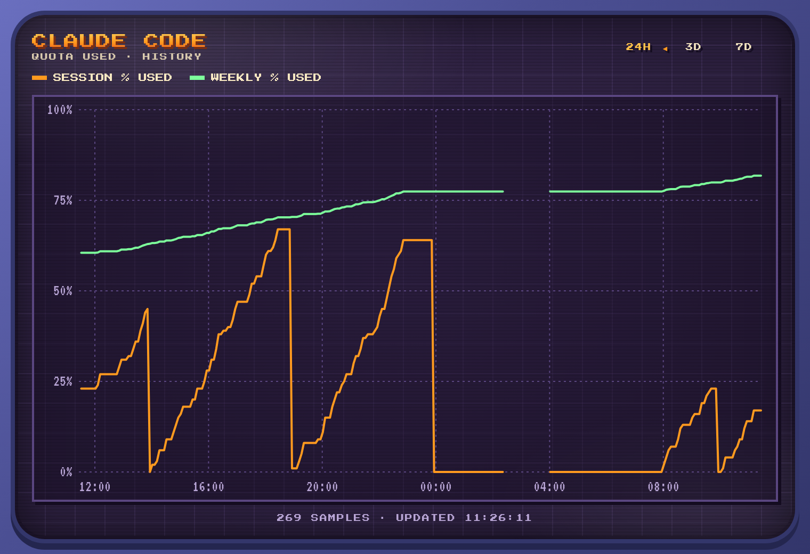
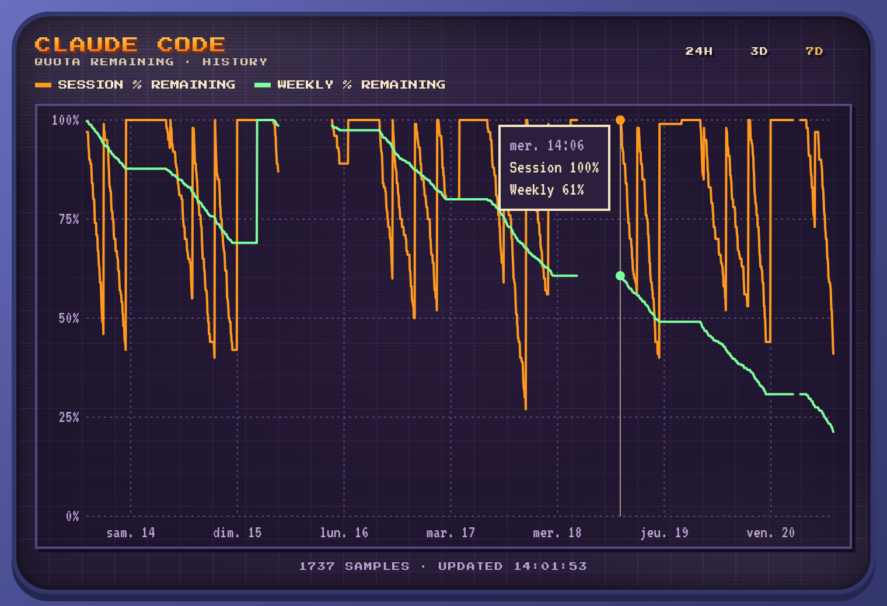

<div align="center">


# BAILS

**TOKEN WATCH** · *le jeton qui garde un œil sur vos tokens*

Une petite fenêtre de bureau rétro-arcade qui affiche, en temps réel, l'usage de vos abonnements CLI IA :
fenêtres de rate-limit, % restant et compte à rebours avant reset.


[](LICENSE)



</div>

---

## ▶ PRESS START

```sh
npm install
npm run dev        # lancer en dev (rechargement à chaud de l'UI)
npm test           # tests des parsers et du service
npm run typecheck  # vérification TypeScript
npm run build      # build de production dans out/
npm start          # lancer le build de production
```

> 💡 Les messages `Fontconfig warning` et `GetVSyncParametersIfAvailable() failed` au lancement
> viennent du système / de Chromium et sont sans conséquence.

## 💾 INSTALLATION

Téléchargez l'installeur de votre OS dans les [Releases](https://github.com/hansipie/Bails/releases) :

| OS | Fichier |
|---|---|
| macOS (Apple Silicon) | `Bails-x.y.z-mac-arm64.dmg` |
| macOS (Intel) | `Bails-x.y.z-mac-x64.dmg` |
| Windows | `Bails-x.y.z-win-x64.exe` |
| Linux (toutes distros) | `Bails-x.y.z-linux-x86_64.AppImage` |
| Debian / Ubuntu | `Bails-x.y.z-linux-amd64.deb` |
| Fedora / RHEL | `Bails-x.y.z-linux-x86_64.rpm` |

> ✅ **macOS** : l'app est signée (Developer ID) et notarisée par Apple, elle s'ouvre directement.
>
> ⚠️ Les autres binaires ne sont pas signés :
> - **Windows** : SmartScreen › *Informations complémentaires* › *Exécuter quand même*.
> - **AppImage** : `chmod +x Bails-*.AppImage` puis lancez-le.

## 🚀 RELEASE

```sh
npm version patch          # ou minor / major : met à jour package.json et crée le tag vX.Y.Z
git push --follow-tags     # le workflow GitHub construit macOS, Windows, Linux et publie la release
```

Le workflow [`.github/workflows/release.yml`](.github/workflows/release.yml) vérifie que le tag
correspond à la version de `package.json`, lance typecheck + tests, package les 3 OS puis publie
la release avec les installeurs et un fichier `SHA256SUMS.txt`.
La description de la release est la section `## [X.Y.Z]` de [`CHANGELOG.md`](CHANGELOG.md),
extraite par `scripts/release-notes.mjs` : remplis-la **avant** de créer le tag, sinon le workflow
s'arrête dès le début. Pour vérifier le rendu : `node scripts/release-notes.mjs CHANGELOG.md X.Y.Z`.
Il peut aussi être lancé à la main (onglet *Actions*) pour un build sans release.

### Signature macOS

Le job macOS signe l'app avec un certificat **Developer ID Application** puis la fait notariser
par Apple. Il échoue si l'un de ces secrets GitHub (*Settings › Secrets and variables › Actions*) manque :

| Secret | Contenu |
|---|---|
| `MAC_CERT_P12_BASE64` | certificat Developer ID Application + clé privée, exporté en `.p12` puis encodé en base64 |
| `MAC_CERT_PASSWORD` | mot de passe du `.p12` |
| `APPLE_ID` | e-mail du compte Apple Developer |
| `APPLE_APP_SPECIFIC_PASSWORD` | mot de passe d'app généré sur [account.apple.com](https://account.apple.com) |
| `APPLE_TEAM_ID` | Team ID (10 caractères, visible sur developer.apple.com › *Membership*) |

En local, `npm run dist` construit les installeurs de l'OS courant dans `dist/`
(`dist:linux`, `dist:win`, `dist:mac` pour cibler un OS ; le `.dmg` exige macOS, le `.rpm` exige `rpmbuild`).

## 🕹️ FEATURES

- **Claude Code** et **Codex** : session 5 h, quota hebdomadaire, dépense on-demand.
- **Antigravity** (Google, CLI `agy`) : quota partagé des modèles Gemini, plus les limites 5 h et
  hebdomadaire du groupe Claude/GPT quand l'API les renvoie.
- **Jauges pixel** façon barre d'énergie : orange → jaune sous 20 % → rouge clignotant à sec.
- **Compte à rebours** avant chaque reset, rafraîchi toutes les 30 s.
- **Auto-refresh** toutes les 5 min, bouton `REFRESH ◀` pour forcer.
- **Email masqué** par défaut (flou), un clic pour le révéler.
- **Commande de connexion à copier** quand un provider n'est pas connecté.
- **Historique** : un clic sur une carte ouvre une fenêtre avec les courbes du quota session et
  hebdomadaire (24 h / 3 j / 7 j), enregistrées localement dans `usage-history.json` (30 jours max).
- **Cartes masquables** : bouton `HIDE` sur chaque carte (le provider n'est alors plus interrogé),
  `Show` dans la barre « Hidden » pour la ramener ; mémorisé dans `settings.json`.
- **Icône dans la barre de notification** : fermer la fenêtre la range dans le tray (clic sur
  l'icône pour la rouvrir, menu pour rafraîchir ou quitter). Sous GNOME, il faut l'extension
  [AppIndicator](https://extensions.gnome.org/extension/615/appindicator-support/).
- **Lancement à l'ouverture de session** (activé par défaut, case « Launch at login » du menu du
  tray) : Bails démarre directement dans le tray. Sous Linux, entrée XDG
  `~/.config/autostart/bails.desktop` ; macOS/Windows : éléments de connexion du système.
- **Fenêtre ajustée au contenu** : la hauteur suit les cartes affichées (limitée à l'écran).
- **100 % local** : polices embarquées, aucune télémétrie, credentials en lecture seule.

<div align="center">




*Vue 24 h · vue 7 jours*

</div>

## ⚙️ HOW IT WORKS

| Provider | Credentials lus (lecture seule) | Endpoint |
|---|---|---|
| Claude Code | `$CLAUDE_CONFIG_DIR/.credentials.json` (défaut `~/.claude`) | `GET https://api.anthropic.com/api/oauth/usage` (`anthropic-beta: oauth-2025-04-20`) |
| Codex | `$CODEX_HOME/auth.json` (défaut `~/.codex`) | `GET https://chatgpt.com/backend-api/wham/usage` (`chatgpt-account-id`) |
| Antigravity | trousseau système, service `gemini` / compte `antigravity` (via `secret-tool` sous Linux, `security` sous macOS) | `POST https://daily-cloudcode-pa.googleapis.com/v1internal:retrieveUserQuota`, `:retrieveUserQuotaSummary`, `:loadCodeAssist` (`User-Agent: antigravity/…`) |

Les fichiers de credentials ne sont **jamais réécrits** et les tokens ne sont jamais rafraîchis :
si un token est expiré ou rejeté, la carte invite à relancer `claude` / `codex login` / `agy`.
Exception pour Antigravity, dont le token expire au bout d'une heure : quand il a expiré, Bails
lance une fois `agy models` (simple liste des modèles, sans consommer de quota), qui renouvelle et
enregistre lui-même son token, puis relit le trousseau. Bails ne touche jamais au token de
rafraîchissement. Si le renouvellement échoue, la carte garde les dernières jauges connues avec
leur heure et invite à relancer `agy` ; Bails ne relance pas `agy` pour ce token avant 15 min.
Antigravity n'est pas encore pris en charge sous Windows. Gemini CLI n'est pas utilisé :
Google n'y accepte plus les comptes individuels et renvoie vers Antigravity.
Ces endpoints ne sont pas documentés publiquement et peuvent changer : les parsers sont
volontairement tolérants (plusieurs noms de champs acceptés).

Le `UsageService` (process main) met le rapport en cache 2 min, dédoublonne les requêtes
concurrentes et applique un backoff exponentiel par provider sur HTTP 429 (1 → 15 min) en
continuant d'afficher le dernier résultat valide.

```
src/
├── main/            process Electron : fenêtres, IPC, UsageService
│   └── usage/
│       ├── history.ts   historique des quotas (usage-history.json)
│       ├── keyring.ts   lecture du trousseau système (secret-tool / security)
│       └── providers/   claude.ts, codex.ts, antigravity.ts
├── preload/         expose window.bails.usage au renderer (rapport + historique)
├── renderer/        UI React (thème arcade : styles.css, UsageView.tsx, HistoryView.tsx)
└── shared/          types partagés (UsageReport, UsageSnapshot…)
resources/           icône de l'app (icon.svg source, icon.png 512×512)
```

## ➕ ADD A PLAYER (nouveau provider)

1. Créer `src/main/usage/providers/<nom>.ts` qui exporte un `UsageProvider` :

   ```ts
   export const monProvider: UsageProvider = {
     id: "mon-provider",
     label: "Mon Provider",
     async fetchSnapshot(ctx) {
       // lire les credentials, appeler getJson(ctx, url, headers),
       // retourner un UsageSnapshot (errorSnapshot(...) pour les cas d'échec)
     }
   };
   ```

2. L'ajouter à la liste de `src/main/usage/providers/index.ts`.

Rien d'autre à toucher : le service, l'IPC et l'UI sont génériques.
Renvoyer `cta: { kind: "terminal", title, command }` pour afficher une commande de connexion à copier.
Pour un nouveau type d'aide (ex. un formulaire de cookie), ajouter une variante à `UsageCta`
dans `src/shared/usage.ts` et son rendu dans `CtaBlock`.

## 🎨 THEME

| Rôle | Couleur |
|---|---|
| Écran | `#2b1f3d` / `#3a2a52` |
| Cadre | `#4b4f93` |
| Orange (titres, jauges) | `#ffc24a` → `#ff9a1f` → `#f2661c` |
| Texte | `#f7e7c1` |

Polices : [Press Start 2P](https://fonts.google.com/specimen/Press+Start+2P) (titres, labels) et
[VT323](https://fonts.google.com/specimen/VT323) (texte, chiffres), embarquées via `@fontsource`.
Icône pixel-art 32×32 dessinée par Codex.

## 📝 CHANGELOG

L'historique des versions est dans [CHANGELOG.md](CHANGELOG.md).

## 📜 LICENSE

[MIT](LICENSE) © 2026 ansicode.

Les polices Press Start 2P et VT323 sont distribuées sous
[SIL Open Font License 1.1](https://openfontlicense.org/) ; Electron et React sous licence MIT.

<div align="center">

**GAME OVER?** &nbsp;·&nbsp; *INSERT COIN TO CONTINUE* &nbsp;◀

</div>
